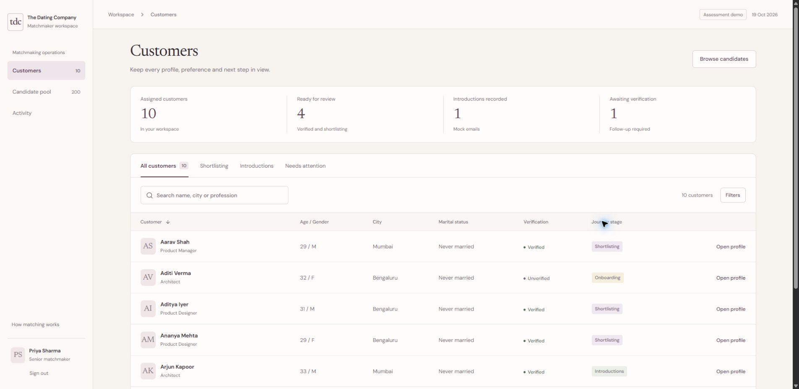
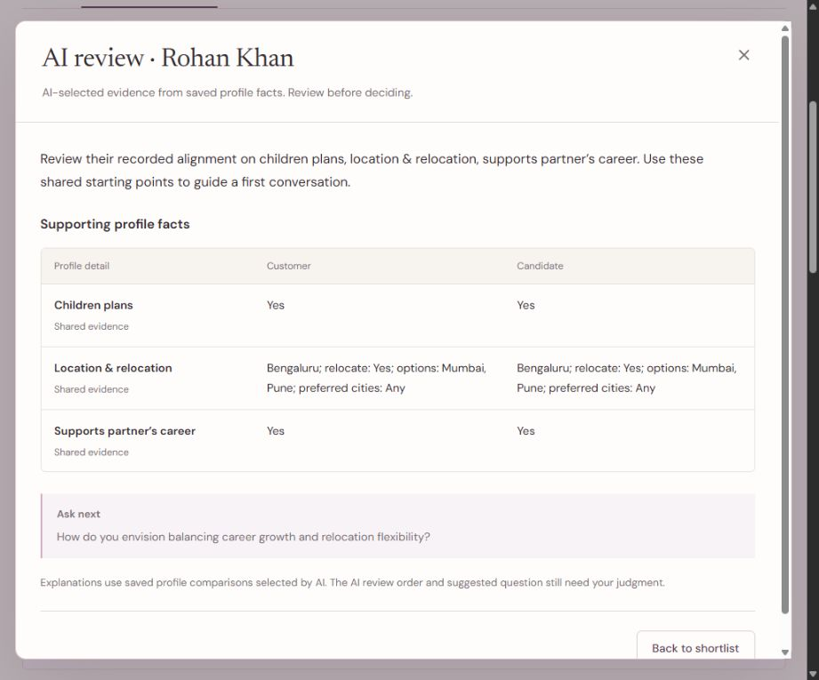
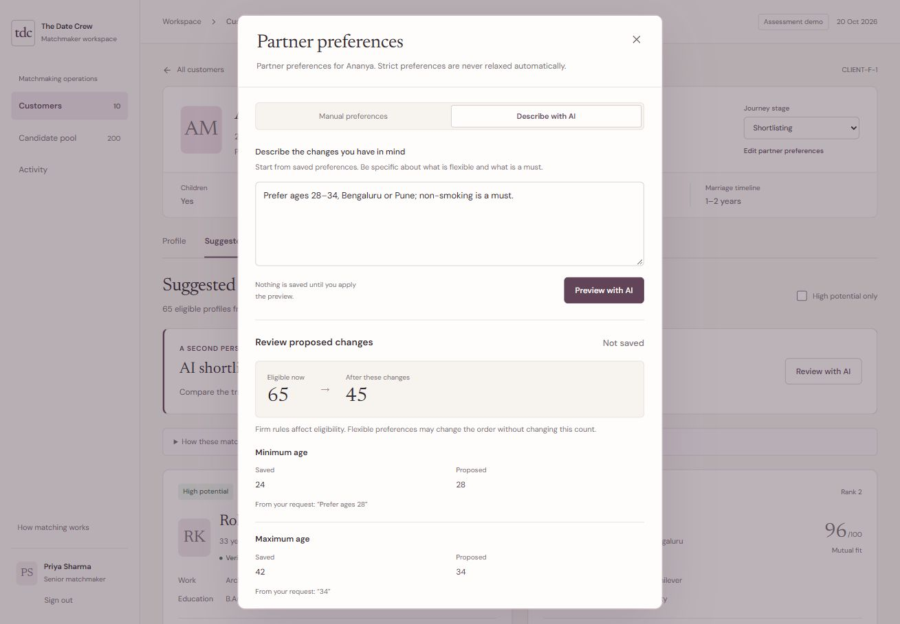
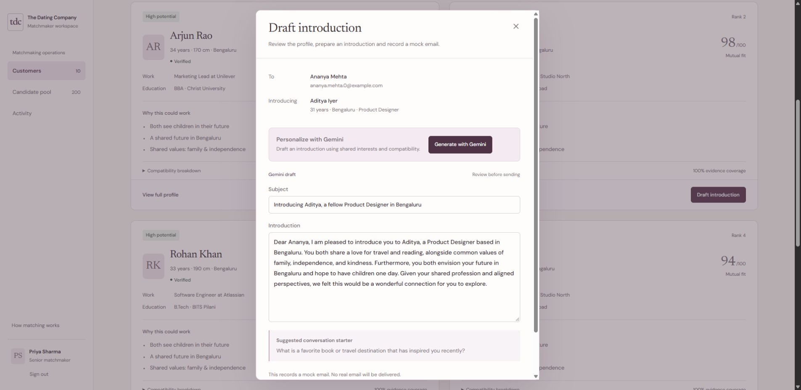

# The Date Crew · Matchmaker Workspace

A polished MERN assessment MVP for customer care, explainable shortlists, meeting notes, and reviewed introductions.



## Deployment

- Frontend: [date-crew-matchmaker.vercel.app](https://date-crew-matchmaker.vercel.app)
- API: [date-crew-matchmaker-api.onrender.com/api/health](https://date-crew-matchmaker-api.onrender.com/api/health)
- Source: [dhanishkasharma/date-crew-matchmaker](https://github.com/dhanishkasharma/date-crew-matchmaker)

The frontend and API are live. Production login, session refresh, assignment isolation, Atlas data and Gemini draft generation have been verified. See [deployment instructions](docs/DEPLOYMENT.md).

## Run

```powershell
cd C:\Users\saara\Matchmaker
rtk npm install
rtk node scripts/setup-env.mjs
rtk npm run dev
```

Open **http://127.0.0.1:5173**. Login: **priya / TdcDemo2026!**. A second account, **rohan / TdcDemo2026!**, sees a separate assignment list.

The app runs a disk-persisted development MongoDB if `MONGODB_URI` is empty. A MongoDB binary downloads on the first launch. Connect Atlas and Gemini using [the setup guide](docs/SETUP.md). `.env` is ignored and is never sent to the browser. Gemini uses a labeled template until a valid key and quota are available.

## Included

- Session-based username/password login and assignment-based authorization.
- Searchable customer dashboard, stage/verification/city filters, full biodata, editable preferences.
- 12 assigned customers, 100 female and 100 male candidate profiles; fictional data only.
- Mutual preference matching, assessment-specific male eligibility, transparent score components and evidence coverage.
- Notes and activity timeline with MongoDB persistence.
- Server-side Gemini introduction generation, editable drafts, honest template fallback.
- AI shortlist review of eight eligible candidates, evidence comparisons, preserved concerns and selectable AI/mutual-fit ordering.
- Natural-language preference previews with exact requested changes, pool counts, explicit Apply and stale-preview protection.
- Mock-email preview, persisted send history, unique send constraint, server-side eligibility re-check.
- Responsive layouts, native accessible dialogs, keyboard focus, reduced-motion handling.

## Verification

```powershell
rtk npm run typecheck
rtk npm run lint
rtk npm test
rtk npm run build
```

`npm run test:e2e` runs five Playwright scenarios against an isolated MongoDB and ports 4100/5174. Install its browser with `npx playwright install chromium --only-shell`. Unit/API tests and browser scenarios do not spend live AI quota or change Atlas data. CI runs the same checks.

## Read and review

- [Implementation plan](PLAN.md)
- [MongoDB and Gemini setup](docs/SETUP.md)
- [Required 3-paragraph algorithm explanation](docs/ALGORITHM.md)
- [Architecture and deliberate tradeoffs](docs/ARCHITECTURE.md)
- [Product research](docs/RESEARCH.md)
- [Interface direction and design decisions](docs/UI-DESIGN.md)
- [Render and Vercel deployment](docs/DEPLOYMENT.md)

## Five-minute demo

1. Sign in as Priya and search for Ananya.
2. Inspect the full profile and open partner preferences.
3. Explore suggested matches; inspect eligibility and score details.
4. Add a call note, refresh, and confirm it remains.
5. Choose Review with AI, switch review order and inspect a candidate's supporting facts. In partner preferences, use Describe with AI and preview "Prefer ages 28–34, Bengaluru or Pune; non-smoking is a must." Review changes before applying.
6. Open Send Match, choose Generate with AI, review the editable draft, and record a mock email.
7. Refresh to confirm the candidate remains Sent; inspect Notes & activity. Open Arjun's shortlist to explain the male-policy differences. Sign in as Rohan to demonstrate assignment isolation.

## AI enhancement verification — 20 October 2026

The interface uses provider-neutral AI labels. The provider remains server-side Gemini; `gemini-3.5-flash-lite` passed the live shortlist/preference evaluation and is the new default after the previously configured model returned repeated 503/504 errors. No additional API key, database collection or paid service is required. Review exact results and limitations in [AI evaluation](docs/AI-EVALUATION.md).

66 unit/API tests and five isolated browser scenarios pass. The four live AI evaluation cases pass with the configured replacement model. The local browser walkthrough also verified a real preference preview with before/after pool counts; no preference changes were applied during that walkthrough. Type checking, lint, formatting and the production build are release gates.

Run `npm run evaluate:ai -- --live` explicitly to repeat the four fictional-fixture checks using your configured quota. This does not write to the database. Run `npm run demo:refresh-text` for a dry run of the legacy bio/career-text migration; add `-- --apply` to update only recognized legacy text. Existing notes, sends and preferences are preserved.





## Current external setup

Credentials are supplied privately through the ignored local `.env`. MongoDB and live Gemini introductions have been verified with that configuration. Credentials are never bundled in the repository. The repository, Vercel frontend and Render API are published. Atlas connectivity and live Gemini drafting have been verified through the public app. The app never sends a real email. Verification is simulated. Real personal data and production onboarding need additional operational controls beyond this assessment.

## Validation on 19 October 2026

41 unit/API/provider-boundary tests passed against a separate real MongoDB test database. Type checking, lint, and the production build passed. A browser walkthrough verified sign-in, customer search, full biodata, saved notes after refresh, labeled missing-key fallback, and persisted mock-send state. Playwright scenarios are supplied but were not run as an automated suite in this session. A subsequent service check verified configured MongoDB access, all 200 candidates, and a live structured Gemini introduction using `gemini-3.8-flash`.

With the app running, `npm run check:services` repeats the end-to-end connection check, including one live introduction request. `npm run check:gemini` makes a small provider check. Both commands omit secrets from their output; generation uses your project's quota.

The interface revision uses the selected ivory and plum palette, Newsreader profile headings and DM Sans controls. A customer brief keeps life-plan criteria visible above the shortlist. Candidate cards separate profile facts, compatibility evidence, score details and the introduction action. The introduction editor is a separate component, with visible template/Gemini states and an explicit mock-send step. Desktop and 390px mobile layouts were reviewed; live Gemini generation was also verified in the editor.

### Production verification

The public Vercel app was verified against the Render API and Atlas on 19 October 2026: health returned HTTP 200, Priya received 10 customers, Rohan received 2, both saw the 200-profile pool, and Rohan’s request for Priya’s customer returned 404. Session cookies were HttpOnly, Secure and SameSite=Lax; authenticated API responses used no-store. A browser refresh retained login and the direct customer route. Live Gemini generation succeeded after one transient provider timeout, which correctly displayed the template fallback. The generated draft was reviewed and cancelled without sending.


