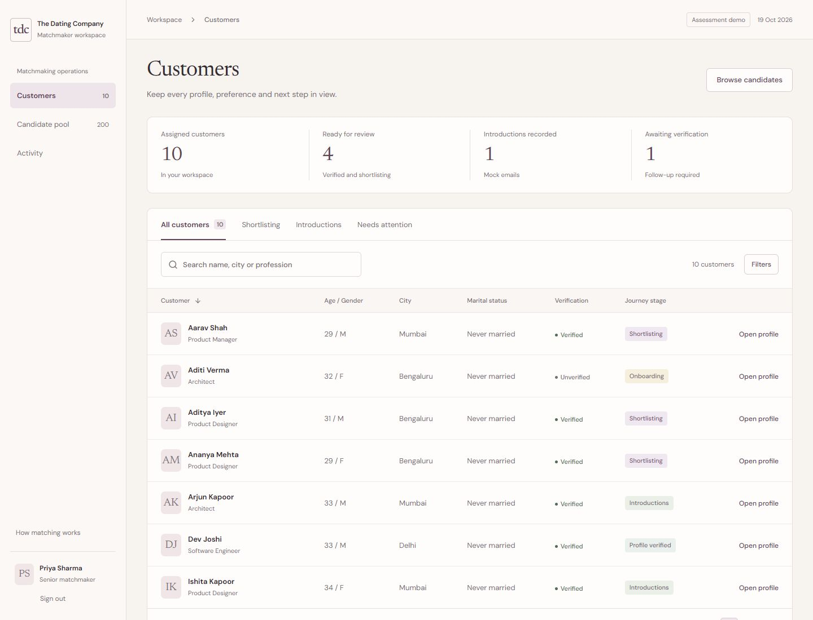

# TDC · Matchmaker Workspace

A polished MERN assessment MVP for customer care, explainable shortlists, meeting notes, and reviewed introductions.



## Run

```powershell
cd C:\Users\saara\Matchmaker
rtk npm install
rtk node scripts/setup-env.mjs
rtk npm run dev
```

Open **http://127.0.0.1:5173**. Login: **priya / TdcDemo2026!**. A second account, **rohan / TdcDemo2026!**, sees a separate assignment list.

The app runs a disk-persisted development MongoDB if `MONGODB_URI` is empty. A MongoDB binary downloads on the first launch. Connect Atlas and Gemini using [the setup guide](docs/SETUP.md). `.env` is ignored and is never sent to the browser. Gemini uses a labeled template until a valid key and quota are available.

## Included

- Session-based username/password login and assignment-based authorization.
- Searchable customer dashboard, stage/verification/city filters, full biodata, editable preferences.
- 12 assigned customers, 100 female and 100 male candidate profiles; fictional data only.
- Mutual preference matching, assessment-specific male eligibility, transparent score components and evidence coverage.
- Notes and activity timeline with MongoDB persistence.
- Server-side Gemini introduction generation, editable drafts, honest template fallback.
- Mock-email preview, persisted send history, unique send constraint, server-side eligibility re-check.
- Responsive layouts, native accessible dialogs, keyboard focus, reduced-motion handling.

## Verification

```powershell
rtk npm run typecheck
rtk npm run lint
rtk npm test
rtk npm run build
```

`npm run test:e2e` runs the supplied Playwright scenarios when a Chromium browser is installed (`npx playwright install chromium`). Unit/API tests use a separate temporary MongoDB and mock provider calls; they do not spend Gemini quota or change your app's notes.

## Read and review

- [Implementation plan](PLAN.md)
- [MongoDB and Gemini setup](docs/SETUP.md)
- [Required 3-paragraph algorithm explanation](docs/ALGORITHM.md)
- [Architecture and deliberate tradeoffs](docs/ARCHITECTURE.md)
- [Product research](docs/RESEARCH.md)
- [Interface direction and design decisions](docs/UI-DESIGN.md)

## Five-minute demo

1. Sign in as Priya and search for Ananya.
2. Inspect the full profile and open partner preferences.
3. Explore suggested matches; inspect eligibility and score details.
4. Add a call note, refresh, and confirm it remains.
5. Open Draft introduction, choose Generate with Gemini, review the editable draft, and record a mock email.
6. Refresh to confirm the candidate remains Sent; inspect Notes & activity.
7. Open Arjun's shortlist to explain the male-policy differences. Sign in as Rohan to demonstrate assignment isolation.

## Current external setup

Credentials are supplied privately through the ignored local `.env`. MongoDB and live Gemini introductions have been verified with that configuration. Credentials are never bundled in the repository. GitHub publication and hosting remain pending. The app never sends a real email. Verification is simulated. Real personal data and production onboarding need additional operational controls beyond this assessment.

## Validation on 19 October 2026

41 unit/API/provider-boundary tests passed against a separate real MongoDB test database. Type checking, lint, and the production build passed. A browser walkthrough verified sign-in, customer search, full biodata, saved notes after refresh, labeled missing-key fallback, and persisted mock-send state. Playwright scenarios are supplied but were not run as an automated suite in this session. A subsequent service check verified configured MongoDB access, all 200 candidates, and a live structured Gemini introduction using `gemini-3.8-flash`.

With the app running, `npm run check:services` repeats the end-to-end connection check, including one live introduction request. `npm run check:gemini` makes a small provider check. Both commands omit secrets from their output; generation uses your project's quota.

The interface revision uses the selected ivory and plum palette, Newsreader profile headings and DM Sans controls. A customer brief keeps life-plan criteria visible above the shortlist. Candidate cards separate profile facts, compatibility evidence, score details and the introduction action. The introduction editor is a separate component, with visible template/Gemini states and an explicit mock-send step. Desktop and 390px mobile layouts were reviewed; live Gemini generation was also verified in the editor.
